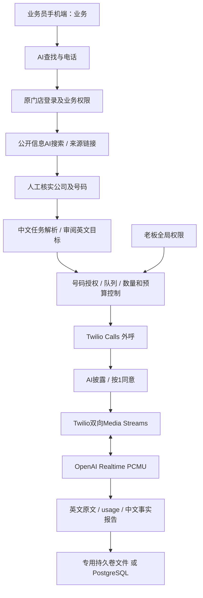

# 架构、实施计划与费用

核对日期：2026-11-12（America/Los_Angeles）。官方资料支持接口可行性，不代表当前账号已获权限或真实电话已验收。

## 现状与设计决定

原门店代码有可插话的中文电话测试模块、Twilio来电转接和短信服务，任务记录仅内存保存。新功能作为独立模块接入现有服务器，共用业务员登录与服务器密钥读取函数，不迁移或覆盖门店数据。此次基线为 film-shop-management/main `27edd40`。

MVP沿用现有Node.js、响应式网页和ws依赖，避免为手机入口引入第二套登录或服务。前端5秒轮询状态，实时语音使用WebSocket。React/Next.js、Tailwind和状态WebSocket推送可在稳定后迁移，本次未声称已采用这些技术。

## 官方接口与可实现范围

| 能力 | 直接提供的能力 | 应用必须实现 |
|---|---|---|
| [Twilio Calls](https://www.twilio.com/docs/voice/api/call-resource) | 真实外呼、状态回调、时长限制及挂断 | 任务授权、重复拨号防护、签名与身份核验、审计 |
| [双向Media Streams](https://www.twilio.com/docs/voice/media-streams) | 接收对方音频并向电话播放音频 | WSS桥接、身份校验、同意流程、故障断开 |
| [Twilio WS消息](https://www.twilio.com/docs/voice/media-streams/websocket-messages) | media、mark、clear | 插话清除队列、已播放位置与模型上下文同步 |
| [Realtime对话](https://developers.openai.com/api/docs/guides/realtime-conversations) | 实时音频、VAD、转写、工具事件 | 英文任务提示词、权限边界、结束电话策略 |
| [Realtime客户端事件](https://developers.openai.com/api/reference/resources/realtime/client-events) | PCMU会话设置、追加音频、截断条目 | Twilio与OpenAI事件映射、超时、背压 |
| [AI联网搜索](https://developers.openai.com/api/docs/guides/tools-web-search) | Responses API web_search及来源注释 | 中文搜索界面、来源渲染、记录隔离、查询限额与号码复核 |

搜索使用 `tool_choice=required`，只有服务端返回完整的web_search调用及来源引用才显示成功。网页内容不能授权拨号。报告只将对方转写作为业务事实来源，保留英文引用，并拦截没有依据ID、非字面引用及数字不匹配的事实。翻译与语音识别仍可能出错，不能以代码检查代替人工核对。

## 数据、权限与扩展

- 文件模式原子替换、fsync、进程内串行事务；仅单实例。断电/崩溃可能发生在服务商已接单而回包未保存的窗口，此时状态未知，禁止自动重拨。
- PostgreSQL模式使用单行JSONB聚合和 `SELECT FOR UPDATE`，跨进程串行化任务认领；代码实现但本次没有实库测试。此方式适合小规模MVP，后续应拆出employees/tasks/calls/transcripts/audit表和索引。
- 持久任务队列由数据库/文件驱动，10秒一次；单次定时审批，错过15分钟撤销。当前不依赖Redis。扩为10员工时再引入Redis/BullMQ、独立媒体工作进程和并发配额；外呼提交不可盲目重试。
- 新记录保留ownerId。业务员GET及所有操作都执行记录权限检查，老板可查看全部。原公共客户池及私有成交客户规则不作改变。
- 当前专用模块只增加公开搜索功能，不向AI发送门店客户库或未授权报价。内部库存与报价继续使用原有权限接口。
- 数据文件含电话号码、英文转写与授权依据，应纳入备份及访问限制；上线前确定保留期限。当前不自动删除历史记录，不保存录音。

## 开发与验收顺序

1. 本地基础项目、接口及模拟验证：已实现。
2. 手机业务入口、现有配置读取、记录权限与真实服务接口：已实现，已做隔离测试。
3. 云端发布并检查现有服务配置，做一次真实AI公开搜索；无电话费用。
4. 接听人明确授权新测试号码后，先进行一通最长3分钟真人英文电话。核对插话、口音、数字与停止开关。
5. 分别进行餐厅可用性、CNC询价、包机询价；只采集资料，付款及约束性承诺仍由老板确认。
6. 对照九项验收标准记录实际结果，再开放日常使用。
7. 完成分表、保留策略、Redis和多员工并发后扩展。

传统开发工作量估算：本类MVP约60–120工程小时，含16–32小时集成与真人验收；取决于账号权限、电话服务审核和真实音质问题。若按每小时50–100美元外包，规划范围约3,000–12,000美元；这是工作量假设，非报价或已发生费用。

## 运行费用估算

[Twilio美国官方定价](https://www.twilio.com/en-us/voice/pricing/us)：美国普通本地外呼起始价0.014美元/分钟，Media Streams 0.0044美元/分钟，语音信箱检测0.0075美元/次，普通本地号码1.15美元/月。现有号码复用无需额外购买。特殊目的地、税费与实际账号费率另计。

[gpt-realtime官方模型价格](https://developers.openai.com/api/docs/models/gpt-realtime)：音频输入32美元/百万tokens，音频输出64美元/百万tokens。AI按tokens计费，不能保证固定每分钟总价。规划时可先预留约0.10–0.30美元/通话分钟，另计文字解析、报告、转写及搜索；这是工程估算，不是供应商固定费率。长上下文、说话比例和多轮累计会改变费用。

[OpenAI定价页](https://developers.openai.com/api/docs/pricing)列出web_search工具费及模型输入输出费，AI搜索并不包含在电话分钟费中。应用保留usage但不把Twilio的Call.price当成全部费用。每天搜索限制20次/账号，失败也计入额度。

[Railway官方计费说明](https://docs.railway.com/pricing)：Hobby每月5美元起且抵扣资源使用，超出按实际资源收费。独立应用加数据库的小规模规划预算可先留15–40美元/月；复用现有门店进程通常只增加实际计算和存储用量，不能保证没有增量费用。

例：每月300分钟按0.10–0.30美元估算约30–90美元，另加云资源、号码、搜索、文字处理与税费。每分钟1美元的程序预算预留是防护阈值，不是实际价格或服务商硬性账单封顶。

## 电话合规实施范围

[FCC关于AI语音的声明](https://docs.fcc.gov/public/attachments/FCC-24-17A4.pdf)说明AI生成语音属于TCPA人工语音规则范围。不能把“公开商务号码”或“人工输入号码”理解为适用于所有目的地的合法豁免。需要核对任务性质、线路类别、接听方事先同意及适用规则；接通后按1仅用于本系统的语音处理及文字保存同意，不能替代拨打前所需的合法依据。

MVP不营销、不录音；不因按1便自动开放录音。以后启用录音须先确定通话各方所在地和州法、相应告知及同意。当前代码没有开启录音的接口。
